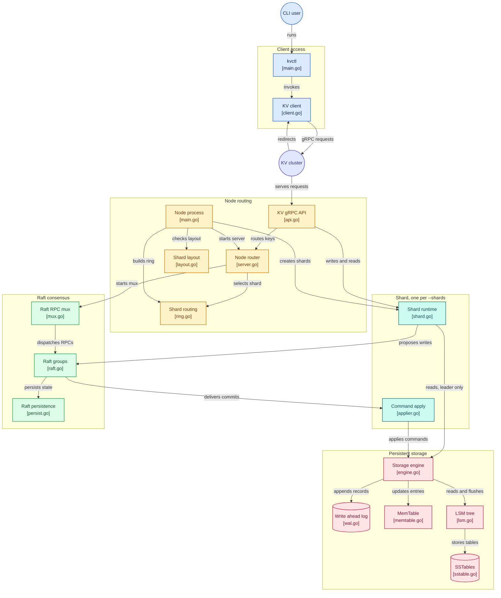

# distributed-kv

A small distributed key value store written in Go. Writes are replicated across a cluster of nodes using the Raft consensus algorithm, data is stored on disk in an LSM tree, and clients talk to it over gRPC.

Keys are split across a fixed number of shards by a consistent hash ring. Each shard is its own replicated Raft group, and every node hosts every shard.

## What it does

- Stores key value pairs and copies every write to every node, so data survives a node going down.
- Offers a small API over gRPC: set a key, read a key, delete a key, and check cluster status.
- Persists data to disk and recovers it on restart.
- Sends a client to the right node automatically when it connects to the wrong one.

## How it works

A node is one process. A three node cluster is three processes, and every node holds a copy of every shard.

```
               node-0         node-1         node-2
            +----------+   +----------+   +----------+
  shard 0   | follower |---|  leader  |---| follower |   Raft group 0
  shard 1   |  leader  |---| follower |---| follower |   Raft group 1
  shard 2   | follower |---| follower |---|  leader  |   Raft group 2
            +----------+   +----------+   +----------+
```

Each row is one Raft group: the three copies of one shard, kept in sync by Raft. Each group elects its own leader, so different shards can be led by different nodes (the placement above is one example). Inside a node, a request takes this path:

```
                        client
                          |   put / get / delete / status (gRPC)
                          v
+--------------------- one node (one process) ---------------------+
|                                                                  |
|  KV API on the client port (Raft port + 1)                       |
|    the hash ring picks the key's shard; if this node does not    |
|    lead that shard, it replies with the leader's address         |
|                         |                                        |
|                         v                                        |
|     +-----------+  +-----------+  +-----------+                  |
|     |  shard 0  |  |  shard 1  |  |  shard 2  |   N = --shards   |
|     |   Raft    |  |   Raft    |  |   Raft    |                  |
|     |  storage  |  |  storage  |  |  storage  |   LSM on disk    |
|     +-----+-----+  +-----+-----+  +-----+-----+                  |
|           |              |              |                        |
|  Raft port: shared by every shard; each message names its shard  |
|                                                                  |
+-------------------------+----------------------------------------+
                          |
                          v
            the same shards on the other nodes
```

Each node listens on two ports: one for talking to peer nodes, and one for the client API. By convention the client port is the peer port plus one. All of a node's shards share the peer port; every message between nodes names its shard.

**Writing a key.** The node hashes the key to find its shard. The write has to go to that shard's leader. If a client sends it to a node that is not, the node replies with the leader's address and the client retries there. The leader records the write in its replicated log and sends it to the other nodes. Once a majority of nodes have it, the write is committed, saved to the leader's storage, and only then is the client told it succeeded.

**Reading a key.** The leader answers from its own storage directly, without going through the log. This is fast. See the consistency note in the decisions below for the trade-off.

## Architecture decisions

The choices that shape the system, and why they were made.

### A write is confirmed only after it is saved, not just after the cluster agrees on it

When the leader tells a client a write succeeded, the data is already written to the leader's own storage. So if you read the same key from that leader immediately after, you will see your write. Confirming earlier, as soon as the cluster agreed, would be faster but a quick follow up read could miss the write, because saving to storage lags agreement.

### Only the leader serves reads, straight from local storage

Reads skip the replication log, which keeps them fast. The trade-off is that a read is not guaranteed to see the latest acknowledged write in two situations:

- A leader cut off from the rest of the cluster keeps answering reads until it notices it has lost contact with a majority and steps down, up to about 350 milliseconds with the default timings.
- A newly elected leader cannot apply writes left over from its predecessor until it commits a write of its own. Until the next write to that shard arrives, a read there can miss a write that was already acknowledged.

The planned fix is ReadIndex: a new leader commits an empty entry as soon as it takes over, and before each read the leader confirms with a majority that it is still the leader and waits until its storage has caught up.

### Clients are redirected, never proxied

A write sent to a follower is refused, with the leader's address attached to the error. The client retries against the leader. The cluster never forwards the write internally on the client's behalf. This keeps each node simple and makes routing visible to the client.

### Retried writes are safe

If a client times out and retries, the same write might be stored twice. Because setting or deleting a key twice has the same result as doing it once, this causes no harm, so the system does not need to track and remove duplicate requests.

### A node that cannot save its state stops

Before it acts, a node must durably record its Raft state (its term, its vote, and its log). If that disk write fails, the node can no longer participate safely, so it shuts down rather than risk corrupting the agreement among nodes. For the same reason, a node whose saved state cannot be read refuses to start: starting blank would let it forget a vote it already cast and vote twice in the same election.

### A node coming back does not disrupt the cluster

A node returning after downtime cannot hear the leader at first, so it times out and wants an election. Left alone it would raise the election term and depose a healthy leader, again and again; the first run of a real three node cluster showed terms jumping from 3 to 40 this way. Three standard Raft extensions prevent it. A node first asks whether it could win before it starts an election (pre-vote). A node that recently heard from a leader refuses to vote for anyone else. And a leader that loses contact with a majority steps down on its own, which also limits how long a cut off leader serves stale reads.

### Restarts never replay old writes

Each write saved to storage carries its position in the replicated log. On restart, storage reports the last position it holds and Raft resumes after it. Reapplying the whole log instead would briefly roll keys back to old values and write every old command to disk a second time.

### Storage is an LSM tree

Writes go to an append only log and an in memory table, which is flushed to sorted files on disk and later merged in the background. This favors fast writes and is the same approach used by stores like Cassandra and RocksDB. Reads check the in memory table first, then the files on disk, using a small in memory index and a bloom filter to avoid unnecessary disk reads.

### Shards on a consistent hash ring, fixed at startup

Keys map to shards through a consistent hash ring with 128 points per shard, so each shard owns a near equal slice of the key space. The shard count is set when a cluster is first started and recorded in each node's data directory; a node refuses to restart with a different count, because that would send existing keys to shards that never stored them.

Every node hosts every shard, so each node still stores everything. What sharding buys on a small cluster is that the leaders of different shards can sit on different nodes, spreading the leader's share of reads and writes. The ring is chosen because adding a shard would move only about one key in N+1, all onto the new shard; moving that data on a live cluster is not built.

## Build and run

The Go module is in the `distributed-kv` directory.

```bash
cd distributed-kv
go build ./...
```

### Run a local three node cluster

The script builds both programs and starts three nodes with three shards on ports 9000, 9010 and 9020 (client ports 9001, 9011, 9021):

```bash
./scripts/cluster-local.sh start         # waits until every shard has a leader
./scripts/cluster-local.sh ctl put k v   # kvctl seeded with all three nodes
./scripts/cluster-local.sh ctl get k
./scripts/cluster-local.sh status        # each node's view of every shard
./scripts/cluster-local.sh kill node-0   # also: crash, revive, stop, wipe
```

To run nodes by hand: each needs a unique id, a peer address, a data directory, the addresses of the other nodes, and the same `--shards` value. The client API binds the peer port plus one. Space the peer ports by at least two so the client ports do not overlap.

```bash
go run ./cmd/node \
  --node-id=node-0 --raft-addr=127.0.0.1:9000 --data-dir=/tmp/kv0 \
  --peers=node-1=127.0.0.1:9010,node-2=127.0.0.1:9020 --shards=3   # client API on 127.0.0.1:9001

go run ./cmd/node \
  --node-id=node-1 --raft-addr=127.0.0.1:9010 --data-dir=/tmp/kv1 \
  --peers=node-0=127.0.0.1:9000,node-2=127.0.0.1:9020 --shards=3   # client API on 127.0.0.1:9011

go run ./cmd/node \
  --node-id=node-2 --raft-addr=127.0.0.1:9020 --data-dir=/tmp/kv2 \
  --peers=node-0=127.0.0.1:9000,node-1=127.0.0.1:9010 --shards=3   # client API on 127.0.0.1:9021
```

`kvctl` (`go run ./cmd/client`) follows leader redirects and prints which node served each call; `--no-follow` shows the rejection instead. `get` exits 2 when the key is missing.

## Testing

Tests run with the race detector and check for leaked goroutines.

```bash
# Everything
go test -race ./...

# The consensus layer, repeated to catch timing flakiness
go test -race -count=10 ./internal/raft/...

# End to end: single node, three node redirect, three nodes x three shards
go test -race -count=5 -run TestKVEndToEnd ./internal/server/...

# Storage under concurrency
go test -race -count=100 ./internal/storage/lsm/...
```

## Project layout

```
internal/
  raft/        Raft: leader election, log replication, durable state
  storage/     LSM engine: write ahead log, in memory table, flush
    lsm/       on disk files, compaction, iterators, bloom filter
  shard/       ties one Raft node to one storage engine, applies committed writes
  server/      gRPC server, request routing, API handlers
  sharding/    consistent hash ring mapping keys to shards
  client/      client library: redirect following and retries
proto/
  raftpb/      messages nodes use to talk to each other
  kvpb/        the client API
cmd/
  node/        the node program
  client/      kvctl, the command line client
scripts/       cluster-local.sh, a local three node cluster
```

### How the files connect

A write leaves the shard through Raft and comes back through the applier into storage, so it is applied only after a majority has it. A read goes from the shard straight to storage, which is why reads are fast and why they are not yet linearizable.



## Limitations

Each of these is a deliberate choice, not an accident.

- **Reads are not linearizable.** A leader cut off from the cluster can serve old data for up to about 350 milliseconds, and a new leader can miss already acknowledged writes until the next write to that shard. The fix, ReadIndex, is planned.
- **The log grows forever.** There is no log compaction or snapshotting yet, so the replicated log and the storage write ahead log grow without bound, each change to the Raft state rewrites the whole log to disk, and a node that falls behind catches up by replaying every entry it missed.
- **No range scans.** You can read a single key, not a range of keys. The storage layer already merges sorted files internally, so a scan would build on that, but it is not exposed yet.
- **Fixed shard count.** Shards cannot be added or removed on a running cluster, and every node holds every shard. Moving keys between shards and placing shards on a subset of nodes are not built.
- **Not deployed yet.** Running it in containers and on Kubernetes comes after the correctness work below.

## What's next

- Linearizable reads with ReadIndex, proven by a fault injection harness that drops, delays and partitions traffic between nodes and checks every recorded history with a linearizability checker.
- Log compaction and snapshots, so the log stops growing and a lagging node catches up from a snapshot.
- Range scans.
- Run it on a local Kubernetes cluster, then on a cloud Kubernetes cluster with the infrastructure defined as code.
- Live resharding and shard placement, but only once the cluster is large enough for it to make a real difference.
